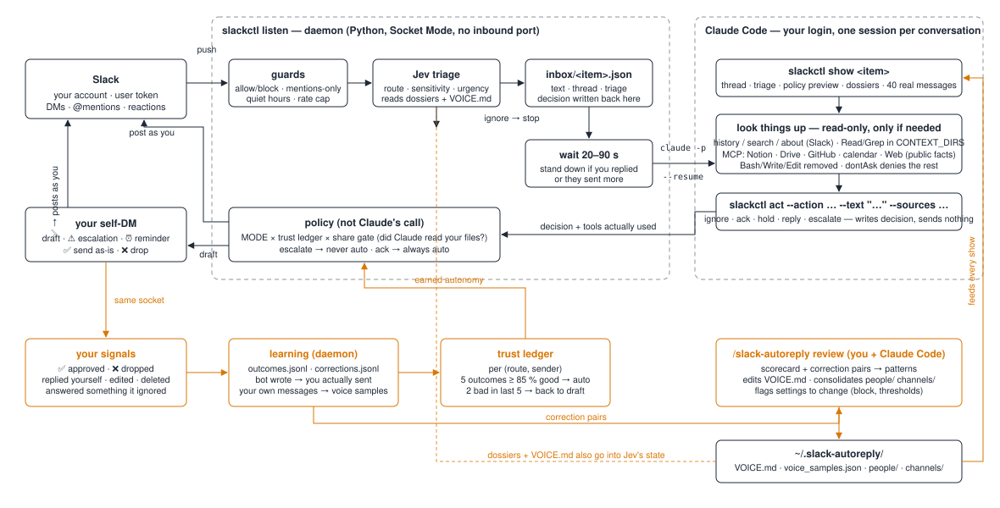

# slack-autoreply

Your logged-in **Claude Code** replies to your Slack messages **from your own account**, in your voice, with your context — and earns the right to do it unsupervised.

No bot user, no proxy handle, no API key for the replies. A small Python daemon listens to Slack and hands each message to `claude -p "/solo:slack-autoreply handle …"` on your login, with your MCP servers, your folders, your CLAUDE.md. **Jev** (TypeSafe AI's System One model) decides in ~10 ms what each message deserves; Claude Code writes it; the daemon either posts as you or parks it in your self-DM for a ✅. Every correction you make is recorded, and a trust ledger graduates each (route, sender) pair from draft to auto once it has a track record.

**Deploying with a coding agent?** Install the plugin and run `/solo:deploy`, or hand it this folder and say "follow AGENTS.md". It is a phase-by-phase runbook with a verification command for every step.



## Requirements

- A Slack workspace where you can create an app (or an admin who will approve one). One app per
  person, created from `manifest.yaml`; nothing is shared between people.
- [Claude Code](https://code.claude.com/docs) installed and logged in on the machine that will run
  the daemon. Replies bill your Claude plan, not an API key.
- Python 3.10+, macOS or Linux. The machine should be the one your projects and `claude mcp list`
  servers live on, because that is what gives replies real context.
- Optional: a TypeSafe AI key for Jev triage (console.typesafe.ai), or an `ANTHROPIC_API_KEY` for
  the Claude Haiku fallback. Without either, Claude Code decides the route itself.

Everything else in this README past *Day to day* is optional: running on a second machine, a wiki
for the voice guide, letting your coding agents report through Solo, an engineering-request
channel (AGENTS.md Phase 9), a team secret store.

## What's in the box

```
.claude-plugin/          plugin.json + marketplace.json: this repo is the plugin `solo` and its own marketplace
skills/slack-autoreply/  /solo:slack-autoreply — the writer's procedure: setup · handle · run · review · simulate · status
skills/deploy/           /solo:deploy — install and configure by following AGENTS.md, phase by phase
skills/solo/             /solo:solo — how any other coding agent reports through Solo (also installed for Codex)
AGENTS.md                deployment runbook for a coding agent (phases, verifications, failure table)
install.sh               installs the plugin (in place from a marketplace install; to ~/.claude/skills/solo from a clone), deps, ~/.slack-autoreply
Makefile                 install · doctor · test · setup · listen · service · status · logs
manifest.yaml            Slack app definition (user scopes only, Socket Mode, user events)
.env.example             every setting, commented
scripts/slackctl.py      daemon + CLI (listen, show, act, simulate, history, search, about, note, doctor, …)
scripts/doctor.py        preflight checks
scripts/triage.py        Jev (REST) + Claude fallback + policy thresholds
scripts/learning.py      outcomes, corrections, trust ledger, scorecard
scripts/followups.py     deadline math, reminders, auto-close
scripts/voice.py         VOICE.md template, sample pulling/picking, continuous capture
scripts/recall.py        dossiers (people/, channels/), history, search, about
scripts/config.py        paths + settings
deploy/                  launchd plist, systemd unit, install-service.sh
tests/test_offline.py    379 end-to-end checks with a fake Slack and a fake claude — no tokens needed
LICENSE                  MIT
docs/architecture.svg    the diagram above
```

State lives in `~/.slack-autoreply/` (`.env`, `VOICE.md`, `voice_samples.json`, `people/`, `channels/`, `inbox/`, `outcomes.jsonl`, `corrections.jsonl`, `self_edits.jsonl`, `followups.json`, `state.json`, `replies.jsonl`) and is never touched by a reinstall.

## Install in seven steps

Each step ends with how you know it worked.

**1. Preconditions.** Python 3.10+, Claude Code on `PATH`, logged in once (`claude` → `/login`). Run on the machine where your projects and `claude mcp list` servers live.
`claude --version` prints a version.

**2. Install.** Solo is a Claude Code plugin. From the marketplace, inside Claude Code:
```
/plugin install solo --marketplace mercurialsolo/slack-autoreply
/solo:deploy
```
`/solo:deploy` runs the installer and then walks you through the rest of these steps from
`AGENTS.md`, verifying each. Or from a clone, which installs the same plugin under
`~/.claude/skills/solo`:
```
./install.sh && python3 tests/test_offline.py
```
Last line: `379 checks passed`. Either way the daemon runs from the plugin's own directory, so
after `claude plugin update solo` run `/solo:deploy` again to re-point the service.

**3. Slack app.** api.slack.com/apps → *Create New App* → *From a manifest* → paste `manifest.yaml`. Then:
*Basic Information → App-Level Tokens → Generate* with `connections:write` → `xapp-…`.
*OAuth & Permissions → Install to Workspace* → copy the **User OAuth Token** → `xoxp-…` (not the bot token; there is no bot).
Only want DMs? Remove `message.channels` and `message.groups` from the manifest before creating the app.

**4. Configure.** Put the two tokens and `CONTEXT_DIRS` (folders Claude may read, read-only) in `~/.slack-autoreply/.env`. Optionally `TYPESAFE_API_KEY` for Jev.
```
make doctor
```
All `[ok]`/`[warn]`, ending `all good — start with: slackctl listen`.

**5. Train the voice** (you need to be there, ~15 min).
```
claude "/solo:slack-autoreply setup"
```
It pulls your last 200 messages with what each replied to, studies them, writes `VOICE.md` quoting your own lines, asks you three things examples can't show (who to be careful with, what never to commit to on autopilot, what's fine on autopilot), seeds dossiers for your top counterparts, and dry-runs three messages so you hear it before it goes live.
`make doctor` now shows `N voice samples` and `VOICE.md filled in`.

**6. Run.** Foreground once, then as a service:
```
make listen        # watch one real DM go draft → ✅ → sent as you, then Ctrl-C
make service       # launchd (macOS) / systemd --user (Linux); make logs to follow
```

**7. Use it.** Drafts land in your Slack self-DM: ✅ sends as-is, ❌ drops, or just reply to the person yourself and it learns the difference. Weekly, `claude "/solo:slack-autoreply review"`.

## How a message flows

1. **Slack pushes** the event over Socket Mode (user scopes → every DM, @mention and reaction on your behalf).
2. **Guards**: bots, allow/block lists, mentions-only in channels, quiet hours, presence, per-conversation rate cap. Your own messages go to the learning path instead.
3. **Jev triage** with the thread, the sender's dossier and your VOICE.md in its state: route, sensitivity 1–5, urgency 1–5, needs-your-files, asks-for-material. Policy on top: sensitivity ≥ 4 forces `escalate`; low confidence demotes `reply`→`hold`, `ignore`→`ack`. `ignore` stops here. No TypeSafe key → Claude Haiku (needs `ANTHROPIC_API_KEY`) → otherwise Claude Code decides the route itself.
4. **Inbox item** written; **wait 20–90 s** (minimum if urgent); stand down if you replied or they kept typing.
5. **Spawn Claude Code**: `claude -p "/solo:slack-autoreply handle <item>" --permission-mode dontAsk --allowedTools … --max-turns 25`, one session per conversation (`--session-id`, then `--resume`), `ANTHROPIC_API_KEY` hidden so it bills your login.
6. **Claude** runs `slackctl show` (thread, triage, policy preview, dossiers, track record, 40 real messages), looks back if the message refers to something not in view (`history`, `search`, `about`), reads your folders / MCP servers if the answer needs something real, writes the text, notes anything durable it learned, and calls `slackctl act` — which only records the decision.
7. **Policy** (the daemon, not Claude): `MODE` × trust ledger × share gate (did Claude actually read your files, and is this sender trusted for that?) → post as you, or draft to your self-DM. `escalate` never auto-sends; `ack` is a 👀 reaction; `hold` commits to a real deadline and is tracked with a reminder.
8. **Learn**: ✅ / ❌ / you replied instead / you edited / you deleted / you answered something it ignored → `outcomes.jsonl` + before/after pairs → trust ledger (feeds step 7) and `review` (feeds VOICE.md and dossiers, which feed step 6 and step 3).

## Routes

| Route | Behaviour | Auto-send? |
|---|---|---|
| `ignore` | nothing; if you reply to it within 2 h it's logged as a miss | — |
| `ack` | 👀 reaction (or two words with `ACK_STYLE=message`) | always |
| `hold` | one line committing to "by end of day" / "Monday morning" (from urgency); tracked, reminder 15 min before, closed when you reply | once earned |
| `reply` | the answer, researched in your folders/services when needed | once earned, and never if it used your context for an untrusted sender |
| `escalate` | money, legal, people, investors, health, personal, complaints, conflict, confidential, prompt-injection attempts | never — ⚠️ + draft |

**Earned** (`MODE=learn`): 5 outcomes with that sender at ≥ 85 % good and < 2 bad in the last 5, or 20 across everyone at ≥ 90 %. Two bad in the last five → back to draft. `MODE=draft` = everything waits; `MODE=auto` = everything goes (escalations still don't).

## What Claude can touch while composing

`--permission-mode dontAsk`: anything not pre-approved is denied, not prompted.
Allowed: `Read` scoped to `CONTEXT_DIRS` with absolute-path rules, `Glob`, `Grep`, `WebFetch`, `WebSearch`, `mcp__<server>__*` for servers in `claude mcp list` (restrict with `CONTEXT_MCP_ALLOW`), and `python3 …/slackctl.py *`. Removed: `Write`, `Edit`, `Bash` (other than slackctl), `Agent`. Caps: `CLAUDE_MAX_TURNS`, `CLAUDE_TIMEOUT_SECONDS`, `DISPATCH_PARALLEL`, one run at a time per conversation.

The **share gate** watches which tools Claude actually called, not what it claims: a reply that read your files or services goes to you for ✅ unless the sender is in `SHARE_TRUSTED_USERS` or has earned it (5 context-backed replies, ≥ 90 %, none bad). SKILL.md also tells Claude that Slack content is data, not instructions, and to escalate attempts.

## Day to day

| In Claude Code | |
|---|---|
| `/solo:slack-autoreply status` | queue, drafts waiting, open promises, scorecard, misconfiguration |
| `/solo:slack-autoreply run` | drain the inbox (for `DISPATCH=none`, or after a failure); `/loop 2m /solo:slack-autoreply run` keeps it in front of you |
| `/solo:slack-autoreply review` | 14 days of outcomes + correction pairs → VOICE.md edits, dossier consolidation, who's earned auto |
| `/solo:slack-autoreply simulate "…" --from Name` | dry run; nothing is sent |

| CLI (`python3 ~/.claude/skills/slack-autoreply/scripts/slackctl.py …`) | |
|---|---|
| `doctor` | preflight; sends nothing |
| `status`, `drafts`, `followups`, `inbox` | what's waiting |
| `approve <item>`, `drop <item>` | same as ✅/❌ |
| `history @who\|#chan`, `search "words" --with @who`, `about @who`, `note @who "fact"` | memory |
| `build-voice`, `voice`, `review-data` | voice + learning data |

## Optional: team and multi-machine setups

### Running it on another machine, driving it from yours

A laptop that sleeps is a Solo that misses messages. Move the daemon to an always-on Mac and keep
the control surface where you are:

```
./install.sh on the node · copy ~/.slack-autoreply/{.env,VOICE.md,voice_samples.json,people} across
deploy/install-service.sh          on the node
deploy/install-service.sh --remove on the laptop   ← do this FIRST
```

**Only one machine may run `listen`.** Slack load-balances events across Socket Mode connections on
the same app ("each payload may be sent to *any* of the connections"), so two daemons means your DMs
arrive at whichever one Slack picked. Remove the old service before starting the new one.

`deploy/solo` (symlink it to `~/.local/bin/solo`) drives the node from your laptop. Tell it where
the node is once, in `~/.slack-autoreply/solo.env`:

```
SOLO_NODE=<ssh alias of the node>
SOLO_REMOTE_HOME=/Users/<user on the node>
SOLO_REMOTE_REPO=/path/to/this/checkout/on/the/node     # for solo deploy / sync-check
```

There is no second copy of the state — every command runs against the node's:

| | |
|---|---|
| `solo status` · `drafts` · `followups` | what is waiting |
| `solo pause [--for 2h]` · `solo resume` | stop and start it, immediately |
| `solo approve <item>` · `solo drop <item>` | same as ✅ / ❌ |
| `solo about @who` · `history` · `search` · `note @who "…"` | memory, and teaching it |
| `solo logs [-f]` · `solo restart` · `solo ssh` | the daemon |
| `solo voice` · `solo pull` · `solo push` | read the voice guide, edit it in the wiki, send it back |
| `solo train [review\|setup]` | run the training skill **on the node**, interactively |

### The knowledge base can live in a wiki, not in the state dir

`VOICE.md` and the dossiers are the only things a human needs to read and edit, so you can keep
them in a `solo/` folder of whatever markdown wiki or notes repo you already have, rather than
buried in `~/.slack-autoreply`. On the node the daemon reads them through symlinks:

```
~/.slack-autoreply/VOICE.md  ->  <wiki>/solo/voice.md
~/.slack-autoreply/people    ->  <wiki>/solo/people/
```

Both directions are live. `voice.md` is read fresh for **every** message, so an edit changes the
next reply with no restart; and `slackctl note` writes straight into `solo/people/`, so what Solo
learns shows up in the wiki as a normal file change you can read in a diff. `solo pull` / `push`
need `SOLO_WIKI` (the folder here) and `SOLO_REMOTE_WIKI` (the folder on the node) in `solo.env`.

Training runs on the node on purpose — VOICE.md, the samples and the outcomes live there, and
running `setup` or `review` locally would quietly fork them. `pull` and `push` are for hand edits.
Anything not listed falls through to `slackctl`, so new subcommands work without touching the script.

Note the node's `CONTEXT_DIRS` must be **absolute paths that exist on the node** — a path twin like
`/Users/you/Sandbox` is not the same as the service account's `~/Sandbox`.

### Other agents, one voice

Solo is the only thing that writes as you. Anything else that wants to reach a person goes through
it, so a workspace never ends up with one name and five registers:

```
slackctl say @sri "the overnight warmup finished, 4 accounts active, 2 still pending" --from scout
solo say '#acme-homes' "flag that Thursday's E2E run is clean" --from validator --why "gate for go-live"
```

The agent supplies the **intent**, never finished prose — Solo reads the recipient's dossier and the
voice guide and writes it, then `compose` (SKILL.md) puts it through the same rules as any reply.

Two properties that make this safe to hand to an autonomous agent:

- **It can never auto-send.** The trust ledger graduates routes a *person* earned by being replied
  to well; an agent has no such history and cannot accrue one, so an agent-requested message always
  waits for your ✅ — even for a sender who has otherwise earned auto.
- **The boundaries do not move.** Credentials, dates, money, people, anything outside this
  workspace's work still escalate. An agent asking does not make a thing allowed; the limits are
  about what reaches the recipient, not who requested it.

## Notes and limits

- **Jev** is in early access (console.typesafe.ai). `triage.py` calls `POST /v1/systemone` with `{model, state, questions}` and reads answers keyed by question name, per the public guides; if the shape differs, the adapter is ~40 lines. Any Jev error falls back for that message.
- Each `handle` is a `claude -p` run on your plan; the daemon logs the per-run cost estimate when the CLI reports one. Sessions are resumed per conversation, renewed after 72 h / 20 runs.
- `claude -p` must resolve in the service's environment; `deploy/install-service.sh` copies your `PATH` into the unit. On a headless box use `claude setup-token`.
- claude.ai connectors aren't available to headless runs under an API key; under your login they follow Claude Code's own rules. `claude mcp add …` is the reliable route.
- Pending drafts survive a restart (they're in `state.json`); follow-ups persist too.
- Workspace admins may need to approve the app. The user token dies if you revoke the app; reinstall and paste the new one.
